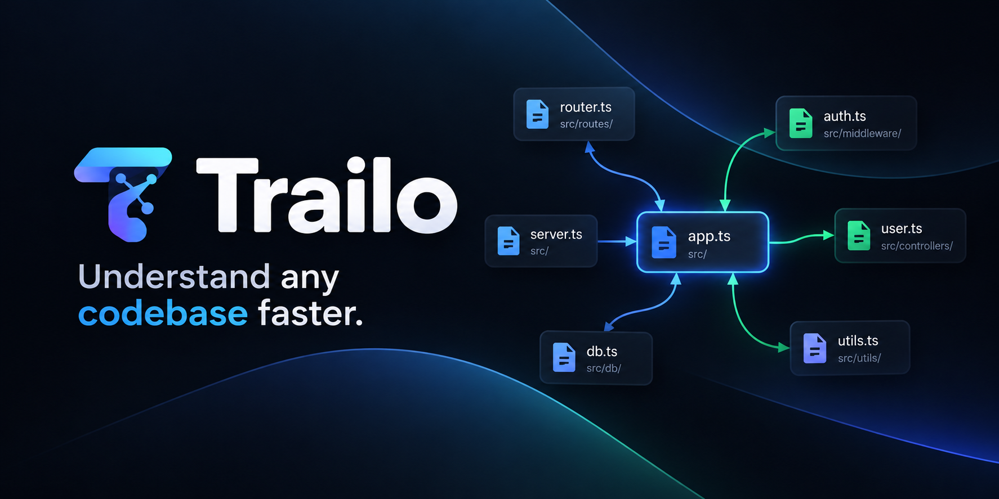

<p align="center">
  
</p>

<p align="center">
  <strong>Local-first developer tool for understanding unfamiliar codebases through AST dependency graphs, source exploration, and evidence-grounded AI intelligence.</strong>
</p>

<p align="center">
  
  
  
  
  
  
  
</p>

---

## 🧭 Overview

**Trailo** is a local-first repository exploration and architectural comprehension platform. Entering an unfamiliar codebase is notoriously slow: developers spend hours tracing imports across nested directories, guessing entry points, and wrestling with unverified assumptions.

Trailo solves this by combining **real, syntax-level AST dependency graph extraction** with an **interactive visual canvas**, **instant read-only source previewing**, and an upcoming **evidence-grounded AI assistant** powered by Gemma.

### Why Trailo?

- 🛡️ **Zero Execution Risk:** Analyzes code purely through AST syntax trees. Never executes, imports, or evals untrusted repository code.
- ⚡ **Local-First & Private:** Repository indexing and graph construction run completely on your local machine. No source code leaves your computer without explicit configuration.
- 🎯 **Truthful Static Graphs:** No hallucinations. Nodes represent real repository files, and directed edges represent verified AST import statements.
- 🔍 **Line-Level Citations:** Grounded code inspection with one-based line numbers, in-memory caching, and directional dependency tracking.

---

## 🚀 Key Features

### 1. Safe & Bounded Repository Scanning
- **Path Traversal Confinement:** Realpath canonical resolution prevents directory escaping (`..`, encoded tokens, null bytes).
- **Symlink Protection:** Automatically breaks junction/symlink cycles and rejects links pointing outside the project root.
- **Strict Ignore Rules:** Skips `.git`, `node_modules`, `dist`, binaries, and secrets (`.env*`, `id_rsa*`).
- **Resource Safeguards:** Bounded scan caps (1,000 files, 500 KB per file, 20 MB total indexed content).

### 2. Syntax-Level JS/TS Dependency Analyzer
- Built directly on the official **TypeScript Compiler API (`typescript@5.9.3`)**.
- Extracts ESM imports (default, named, namespace, side-effect, type-only), ESM re-exports (`export ... from`), CommonJS `require(...)`, dynamic imports, and TypeScript `import = require(...)`.
- Resolves relative paths against indexed files, candidate extensions (`.ts`, `.tsx`, `.js`, `.jsx`, `.mjs`, `.cjs`), directory index files, and TS ESM `.js` specifier mappings.
- Disambiguates internal resolved dependencies from external npm packages and unresolved paths.

### 3. Interactive Graph Canvas
- Powered by **`@xyflow/react`** with pan, zoom, fit-to-view, and minimap radar controls.
- Custom file node cards displaying language badges (`JS`, `TS`, `TSX`, `JSX`), file basename, directory path, line count, and byte size.
- **Deterministic Layered Layout:** Topological BFS layering algorithm positioning connected modules from left to right along dependency depth, with isolated files neatly tiled below.
- **Truthful Empty States:** Distinguishes unindexed repositories, scan in-flight progress, scanner errors, and repositories with zero internal edges.

### 4. Directional Node Selection & Relationship Highlighting
- Selecting any node highlights its immediate architectural neighborhood:
  - **Outgoing Dependencies (Blue):** Files that the selected file imports (`selected -> target`, `↱ Dependency`).
  - **Incoming Dependents (Green):** Files that import the selected file (`source -> selected`, `↳ Dependent`).
  - **Unrelated Nodes & Edges:** Dimmed cleanly without being removed, preserving overall codebase context.
  - **Isolated Nodes:** Cleanly selected and identified with zero incident dependencies.

### 5. Integrated Read-Only Source Viewer
- Side-by-side split workspace displaying the selected file's source code with 1-based line numbers in the gutter.
- Monospace typography with horizontal and vertical scrolling.
- **In-Memory Caching:** Instant switching between previously inspected files with zero redundant network overhead.
- **Race Condition Protection:** Monotonic request tracking ensures that rapid node switching never renders stale file content.
- **Strict Sandbox Retrieval:** Content is served strictly from the in-memory index snapshot; client-provided arbitrary filesystem reads are rejected.

---

## 📐 Architecture

Trailo is structured as an npm workspaces monorepo:

```text
Trailo/
├── assets/                     # Brand visual assets and documentation banners
├── client/                     # Frontend application (React 18, Vite, @xyflow/react)
│   ├── src/
│   │   ├── components/         # ExploreHeader, GraphCanvas, FileNode, SourceViewer
│   │   ├── utils/              # Deterministic layout, selection highlights, source loader
│   │   ├── App.jsx             # Main workspace coordinator
│   │   └── App.css             # Developer dark theme styles
│   └── package.json
├── server/                     # Backend API (Node.js, Express, TypeScript Compiler API)
│   ├── src/
│   │   ├── scanner/            # Safe filesystem walker, traversal defense, ignore policies
│   │   ├── indexer/            # Deterministic line chunker, in-memory index store, scan routes
│   │   ├── analyzer/           # TypeScript Compiler API AST extractor, path resolver
│   │   ├── graph/              # Dependency graph builder and graph API routes
│   │   ├── app.js              # Express app factory (decoupled for testing)
│   │   └── index.js            # Standalone server entrypoint
│   ├── test/                   # Automated unit and integration test suites
│   └── package.json
├── docs/                       # Architectural blueprints, roadmap, and specifications
└── package.json                # Monorepo root workspaces configuration
```

---

## 🛠️ Getting Started

### Prerequisites

- **Node.js:** `v18.0.0` or higher (Node `v20.x` or `v22.x` recommended)
- **npm:** `v9.0.0` or higher

### Installation

1. **Clone the repository:**
   ```bash
   git clone https://github.com/your-username/Trailo.git
   cd Trailo
   ```

2. **Install all dependencies:**
   ```bash
   npm install
   ```

### Running Locally

Run both the backend API and frontend Vite dev server concurrently:

1. **Start the backend server (Port 3000):**
   ```bash
   npm run dev:server
   ```

2. **Start the frontend client (Port 5173):**
   ```bash
   npm run dev:client
   ```

3. **Open Trailo in your browser:**
   Navigate to [http://localhost:5173](http://localhost:5173).

---

## 🧪 Testing & Verification

Trailo follows strict engineering verification. All tests run using Node.js's native test runner (`node --test`), requiring zero heavy third-party testing frameworks.

```bash
# Run complete backend and integration test suite (100 tests across 25 suites)
npm test

# Run frontend production build (Vite)
npm run build:client

# Check whitespace hygiene and EOF newlines
git diff --check
```

### Verified Test Coverage

```text
✔ Health API: Verified server status and uptime
✔ Repository Scanner: Confinement, symlink cycles, limits, binary filters
✔ Source Chunker: Line-aware deterministic chunking, boundary normalization
✔ AST Analyzer: ESM, CommonJS, dynamic imports, candidate extension resolution
✔ Index Store: Fast in-memory lookup and summary calculations
✔ Graph Builder: Cycle-safe graph construction, external node exclusion
✔ Scan & File Routes: In-memory retrieval, path traversal protection
✔ Graph Selection: Incoming/outgoing neighbor classification, isolated nodes
✔ Source Loader: Caching, race condition protection, window receiver binding
```

---

## 🔒 Security & Confinement

Trailo treats all repository code as **untrusted data**:

> [!IMPORTANT]
> **Static Analysis Only:** Trailo uses the TypeScript Compiler API purely as an in-memory parser. It never imports, executes, or evals target source code.

- **Confinement:** Client path requests are strictly normalized to relative POSIX paths. Traversal tokens (`..`), leading slashes, Windows drive letters (`C:`), and URL-encoded sequences (`%2e%2e`) are rejected with `HTTP 400 INVALID_FILE_PATH`.
- **In-Memory Snapshots:** File content requests are served exclusively from the active in-memory index store. Trailo never executes arbitrary filesystem reads from client-supplied paths.
- **Privacy:** Target code stays local. When cloud-based AI providers are configured, only specific, user-inspected code excerpts are transmitted.

---

## 🗺️ Project Roadmap

| Phase | Milestone | Status |
| :---: | :--- | :---: |
| **Phase 0** | Fresh Foundation & Documentation Blueprints | ✅ **Complete** |
| **Phase 1** | App Skeleton & Health Verification | ✅ **Complete** |
| **Phase 2** | Safe Bounded Repository Scanner | ✅ **Complete** |
| **Phase 3** | Indexing Pipeline & TypeScript AST Analyzer | ✅ **Complete** |
| **Phase 4A** | Backend Dependency Graph API | ✅ **Complete** |
| **Phase 4B** | UI Interaction Specification | ✅ **Complete** |
| **Phase 4C** | Interactive Graph, Node Selection & Source Viewer | ✅ **Complete** |
| **Phase 5** | Grounded Q&A Vertical Slice (Ollama / Gemma) | ⏳ *Next Milestone* |
| **Phase 6** | Citation Validation & Navigation | 📋 *Planned* |
| **Phase 7** | Complete Exploration Journey | 📋 *Planned* |
| **Phase 8** | Hardening, Performance Tuning & Release | 📋 *Planned* |

---

## 📄 License

This project is licensed under the [MIT License](LICENSE).
