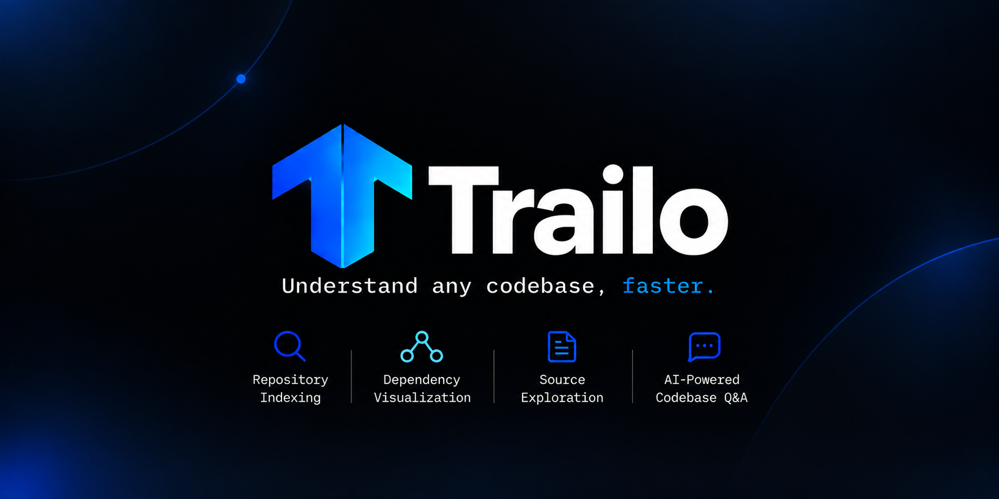

<p align="center">
  
</p>

<p align="center">
  <strong>Local-first developer tool for understanding unfamiliar codebases through AST dependency graphs, source exploration, and evidence-grounded AI intelligence.</strong>
</p>

<p align="center">
  
  
  
  
  
  
  
</p>

---

## 🧭 Overview

**Trailo** helps developers navigate and understand unfamiliar codebases without reading hundreds of files manually. It combines static AST dependency analysis with an interactive visual canvas, side-by-side source code inspection, and an evidence-grounded AI assistant.

### Core Principles

- 🛡️ **Zero Execution Risk:** Analyzes code purely through AST syntax parsing. Never executes, imports, or evaluates untrusted repository code.
- ⚡ **Local-First & Private:** Repository scanning, indexing, and dependency graph generation run 100% locally on your machine.
- 🎯 **Truthful Dependency Graphs:** Nodes represent real files, and directed edges represent verified AST import statements—no guessed links.
- 🔍 **Verifiable Line Citations:** AI answers cite exact 1-based source line ranges validated against the active snapshot.

---

## 🚀 Key Features

### 1. Safe & Bounded Repository Scanner
- **Traversal Defense:** Canonical path resolution prevents directory escaping (`..`, encoded tokens, null bytes).
- **Symlink Protection:** Automatically breaks link/junction cycles and rejects targets outside the project root.
- **Ignore Rules & Bounds:** Skips `.git`, `node_modules`, `dist`, binaries, and secret files (`.env*`, `id_rsa*`) with strict file-count and size caps.

### 2. Syntax-Level AST Dependency Analyzer
- Built directly on the **TypeScript Compiler API (`typescript@5.9.3`)**.
- Extracts ESM imports, ESM re-exports, CommonJS `require(...)`, dynamic imports, and TypeScript `import = require(...)`.
- Resolves relative paths, file extensions (`.ts`, `.tsx`, `.js`, `.jsx`), directory `index` files, and TS ESM `.js` specifier mappings.

### 3. Interactive Graph & Cluster Workspaces
- Visual canvas powered by **`@xyflow/react`** with pan, zoom, fit-view, and minimap radar.
- **Deterministic Layout:** Topological BFS layering arranging modules from left to right along dependency depth.
- **Relationship Highlighting:** Selecting a node highlights immediate outgoing dependencies (blue) and incoming dependents (green).
- **Cluster View:** Groups modules by architectural directories with high-level relationship summaries.

### 4. Integrated Read-Only Source Viewer
- Side-by-side source inspection with 1-based gutter line numbers and syntax styling.
- **In-Memory Caching & Sandboxing:** Content is served exclusively from the in-memory snapshot—never from arbitrary client filesystem paths.
- **Targeted Line Highlighting:** Automatically scrolls to and highlights cited line ranges when navigating from AI answers.

### 5. Grounded AI Codebase Assistant (Ask Trailo)
- **Streaming Q&A:** Real-time token streaming via Server-Sent Events (SSE) powered by Google Gemini (`gemini-3.8-flash`).
- **Evidence Retrieval:** Retrieves and ranks relevant source excerpts from the active repository snapshot.
- **Strict Citation Validation:** Every claim links to verified evidence (`[E1]`). Fabricated or out-of-range citations are stripped.
- **Interactive Navigation:** Click citations in the answer or "Sources Cited" drawer to jump directly to the highlighted code in the Source Viewer.
- **Privacy & Safety:** Clear hosted-AI disclosure; session-only conversation memory (never persisted to storage).

---

## 📐 Architecture

Trailo is organized as a lightweight npm workspaces monorepo:

```text
Trailo/
├── client/                     # Frontend SPA (React 18, Vite, @xyflow/react)
│   ├── src/
│   │   ├── components/         # GraphCanvas, SourceViewer, AskTrailoWorkspace, ClusterView
│   │   ├── utils/              # Graph layout, selection highlights, source caching
│   │   ├── App.jsx             # Main workspace coordinator
│   │   └── App.css             # Dark theme design system
│   └── package.json
├── server/                     # Backend API (Node.js, Express, TypeScript Compiler API)
│   ├── src/
│   │   ├── scanner/            # Safe filesystem walker & ignore policies
│   │   ├── indexer/            # In-memory index store, chunker, scan routes
│   │   ├── analyzer/           # AST syntax dependency extraction & path resolution
│   │   ├── graph/              # Dependency graph builder & graph API routes
│   │   ├── ask/                # Evidence retrieval, Gemini adapter, SSE streaming route
│   │   ├── app.js              # Decoupled Express application factory
│   │   └── index.js            # Server entry point
│   ├── test/                   # Comprehensive automated test suites (310 tests)
│   └── package.json
├── docs/                       # Specifications, architecture, and roadmap
└── package.json                # Monorepo root workspaces configuration
```

---

## 🛠️ Getting Started

### Prerequisites

- **Node.js:** `v18.0.0` or higher (`v20.x` or `v22.x` recommended)
- **npm:** `v9.0.0` or higher
- **Gemini API Key:** Required for Ask Trailo AI features (get one at [Google AI Studio](https://aistudio.google.com/))

### Installation

1. **Clone the repository:**
   ```bash
   git clone https://github.com/Divyanshu0902/Trailo.git
   cd Trailo
   ```

2. **Install dependencies:**
   ```bash
   npm install
   ```

3. **Configure environment:**
   Create a `.env` file in the project root:
   ```env
   GEMINI_API_KEY=your_gemini_api_key_here
   PORT=3000
   ```

### Running Locally

Start the backend server and frontend client concurrently:

```bash
# Terminal 1 — Start the backend API (Port 3000)
npm run dev:server

# Terminal 2 — Start the Vite frontend (Port 5173)
npm run dev:client
```

Open your browser at **[http://localhost:5173](http://localhost:5173)**. Enter any local project path in the sidebar to scan and explore.

---

## 🧪 Testing & Verification

All automated tests use Node.js's native test runner (`node --test`) with zero heavy test frameworks:

```bash
# Run all 310 automated unit and integration tests across 19 suites
npm test

# Run frontend production build (Vite)
npm run build:client

# Verify code formatting and whitespace hygiene
git diff --check
```

### Verified Coverage

- ✔ **Health & Scan APIs:** Uptime checks, path confinement, binary filters, symlink guards
- ✔ **AST Analyzer:** ESM, CommonJS, dynamic imports, candidate extension resolution
- ✔ **Dependency Graph:** Topological layering, incoming/outgoing neighbor classification, cluster grouping
- ✔ **Ask Trailo Core:** Evidence ranking, prompt construction, history bounding, citation validation
- ✔ **Ask Trailo Streaming:** SSE framing, error mapping, multi-chunk buffering, abort handling
- ✔ **Frontend Workspaces:** Graph canvas, source viewer line highlights, streaming Q&A timeline

---

## 🔒 Security & Privacy

- **Static Analysis Only:** Code is parsed purely into syntax trees; it is never executed or evaluated.
- **In-Memory Confinement:** Source requests are served strictly from the in-memory snapshot; arbitrary path traversal is rejected.
- **AI Boundary Transparency:** Source code remains on your machine. When using Ask Trailo, only bounded, relevant excerpts retrieved for your specific question are sent to the Gemini API.

---

## 🗺️ Project Status

| Phase | Milestone | Status |
| :---: | :--- | :---: |
| **Phase 0** | Foundation, Documentation & Agent Contract | ✅ **Complete** |
| **Phase 1** | App Skeleton, Health Verification & Tooling | ✅ **Complete** |
| **Phase 2** | Safe Bounded Repository Scanner | ✅ **Complete** |
| **Phase 3** | Indexing Pipeline & TypeScript AST Analyzer | ✅ **Complete** |
| **Phase 4** | Interactive Graph Canvas, Cluster View & Source Viewer | ✅ **Complete** |
| **Phase 5** | Ask Trailo: Evidence Retrieval & Gemini Streaming Route | ✅ **Complete** |
| **Phase 6** | Citation Validation, Interactive UI & Source Highlighting | ✅ **Complete** |
| **Phase 7** | Complete End-to-End User Journey | ✅ **Complete** |
| **Phase 8** | Verification, Hardening & Release Readiness | ✅ **Complete** |

---

## 👤 Author

**Divyanshu Kumar**
- GitHub: [@Divyanshu0902](https://github.com/Divyanshu0902)
- Repository: [Trailo](https://github.com/Divyanshu0902/Trailo)
