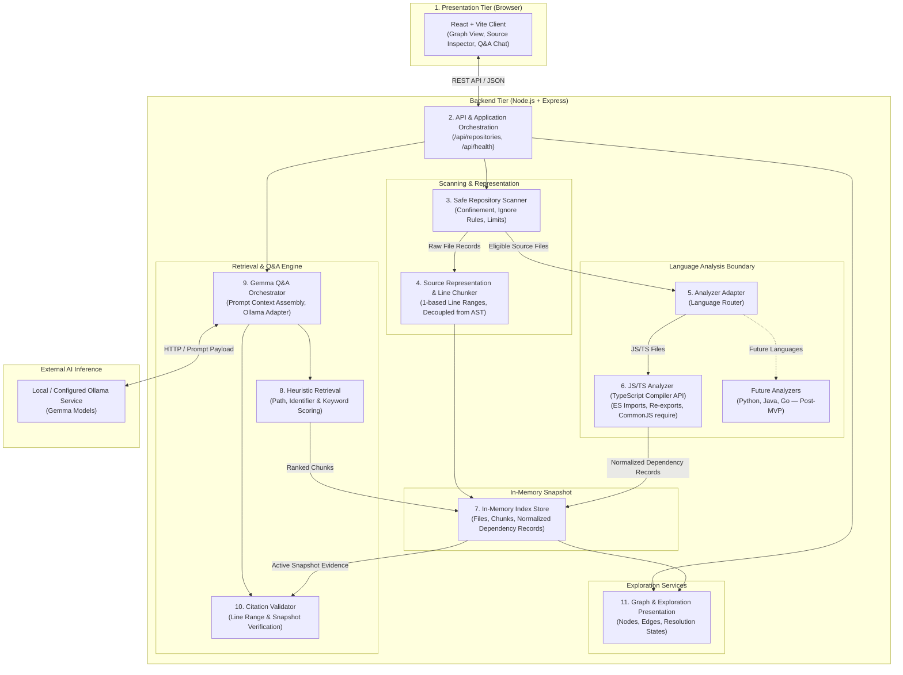
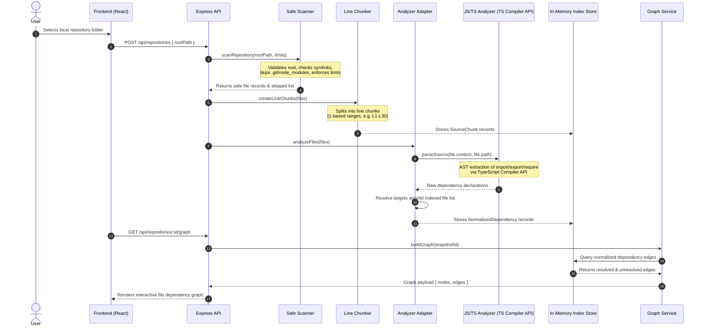
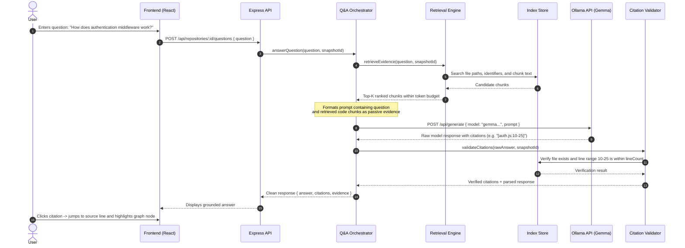

# Trailo — Architecture Guide & System Map

This guide provides a beginner-friendly, layer-by-layer architectural map of Trailo. It explains how each component functions, what data it consumes and produces, and how data moves across the system during codebase exploration and Q&A.

---

## 1. High-Level Architecture Diagram



---

## 2. Layer Breakdown: Responsibilities, Inputs & Outputs

The table below describes the 11 conceptual architecture layers. These represent cohesive modular responsibilities in the codebase, not separate microservices or distributed packages.

| Layer | Responsibility | Inputs | Outputs | Notes |
| :--- | :--- | :--- | :--- | :--- |
| **1. Frontend / UI** | Presents repo selection, indexing progress, dependency graph, source inspector, and Q&A chat. | User gestures, file selection, questions, API responses. | HTTP API requests to `/api/*`. | Never accesses the filesystem directly. Runs in Vite dev server or as static build. |
| **2. API / Orchestration** | Validates incoming HTTP requests, coordinates background services, and maps application errors. | HTTP requests from Frontend (`POST /api/repositories`, etc.). | Structured JSON responses with stable status codes. | Thin controller layer; contains no file-parsing or prompt logic directly. |
| **3. Safe Scanner** | Discovers candidate files beneath an approved root, enforces file limits, skips binaries/secrets, and reads UTF-8 content. | Canonical repository root directory path. | Array of safe file records (`path`, `content`, `lineCount`, `size`, `extension`) + skip metrics. | Strictly passive; never executes scanned code. Guards against symlink escapes and cycles. |
| **4. Source Chunker** | Splits raw file text into deterministic, line-aware text chunks with stable IDs and 1-based line ranges. | File content and normalized path. | Array of `SourceChunk` records (`chunkId`, `path`, `startLine`, `endLine`, `text`). | Strictly line-based; completely independent of language ASTs. |
| **5. Analyzer Adapter** | Inspects file metadata, detects language, and routes source files to the appropriate syntax analyzer. | File records from the scanner. | Dispatched calls to specific language analyzers. | Serves as the stable boundary separating the shared core from language-specific code. |
| **6. Language Analyzer** | Parses source code into a syntax tree to identify import/require declarations and emitted symbols. | Single file `{ path, content, language }`. | Normalized dependency declarations + file symbols + syntax diagnostics. | For JS/TS in the MVP, powered by the TypeScript Compiler API. Does not perform file resolution. |
| **7. Index Store** | Stores repository snapshot data in Node.js process memory for fast querying. | Scanned files, line chunks, and resolved dependency records. | Snapshot lookups by file path, chunk ID, or symbol. | In-memory for the MVP; reset on server restart. No database required. |
| **8. Retrieval Engine** | Scores and ranks chunks matching a user's question using keyword, identifier, and path heuristics. | User question string + target snapshot ID. | Top-K ranked `SourceChunk` evidence records within a token budget. | Evaluates text heuristics first before considering vector embeddings. |
| **9. Gemma Q&A Orchestrator** | Assembles prompt context with retrieved snippets as passive evidence, calls Ollama, and captures the answer. | User question + ranked evidence chunks. | Raw model response text containing answer and proposed citations. | Handles Ollama timeouts and errors gracefully. Keeps provider formatting encapsulated. |
| **10. Citation Validator** | Verifies that all citations produced by the model point to real indexed files and valid line numbers. | Model response text + active snapshot files. | Validated answer object with verified citations, or flagged unsupported citations. | Never trusts model citations blindly; checks line ranges against indexed snapshot. |
| **11. Graph Presentation** | Transforms resolved dependency records into graph nodes, dependency edges, and neighbor clusters. | Normalized dependency records from Index Store. | Graph payload `{ nodes, edges, summary }` ready for UI rendering. | Best-effort static dependency graph; explicitly labeled as not a dynamic runtime call graph. |

---

## 3. End-to-End Data Flow 1: Scanning, Indexing & Graph Construction

When a developer opens a local repository in Trailo, data flows sequentially through the ingestion and analysis tiers:



---

## 4. End-to-End Data Flow 2: Natural Language Q&A & Citation Validation

When a developer asks a question about the indexed repository:



---

## 5. How Layers Communicate & Why Normalized Records Matter

### In-Process Communication
In the MVP, all backend layers communicate via clean, direct JavaScript module imports and function calls (e.g., `await scanRepository(...)`, `await analyzeSource(...)`). There are no internal microservices, message queues, or RPC layers. The only network boundaries are:
1. **Frontend to Backend:** HTTP REST API via JSON (`/api/*`).
2. **Backend to Model Provider:** Local or remote HTTP calls to the Ollama API (`http://127.0.0.1:11434/api/*`).

### The Power of Normalized Dependency Records
A central design principle in Trailo is that **parser-specific AST objects never leak into the shared core**.

Different languages represent imports differently:
- JavaScript/TypeScript: `import { x } from './utils';` or `const x = require('./utils');`
- Python: `from .utils import x` or `import utils`
- Go: `import "myproject/utils"`

If the graph service had to understand TypeScript AST nodes, Python AST nodes, and Go AST nodes, it would become tightly coupled to every language's syntax.

Instead, every language analyzer translates raw AST declarations into a **Normalized Dependency Record**:

```json
{
  "sourcePath": "src/server.js",
  "targetPath": "src/utils.js",
  "specifier": "./utils",
  "kind": "import",
  "language": "javascript",
  "resolutionStatus": "resolved",
  "sourceLocation": {
    "startLine": 1,
    "endLine": 1
  }
}
```

**Why this matters:**
1. **Language-neutral graph:** The graph service only needs to know that file `A` depends on file `B`. It doesn't care whether `A` is JavaScript, TypeScript, or Python.
2. **Separation of parsing and resolution:** The syntax analyzer only extracts what the file declared (e.g. specifier `./utils`). The resolution logic matches `./utils` against the repository's known files (`./utils.js` or `./utils/index.js`).
3. **Honest reporting:** If an import refers to an external package (like `express`) or a missing file, the record marks `resolutionStatus` as `'external'` or `'unresolved'`. The graph visualizes this honestly rather than pretending every import is an internal file.

---

## 6. Language Analyzers vs. Parser Technologies

For a beginner developer, it is important to distinguish the **architecture** (how code is structured) from the **tool** (how code is parsed):

### 1. Analyzer Architecture (The Interface)
The **Language Analyzer Interface** is Trailo's internal contract. Any language module—whether for JavaScript, Python, or Java—implements this standard function signature:
```typescript
analyzeFile({ path: string, content: string, language: string })
  => { dependencies: NormalizedDependency[], symbols: SymbolRecord[], diagnostics: string[] }
```
This is pure logic: it takes text and returns structured data. It has no knowledge of databases, Express routes, or UI components.

### 2. Parser Technology (The Implementation)
The **Parser Technology** is the specific library chosen to parse text into an Abstract Syntax Tree (AST):
- **For the JS/TS MVP: TypeScript Compiler API (`typescript`)**
  - *Why:* It is the official, battle-tested standard for parsing JavaScript and TypeScript. It handles modern ES module syntax, JSX/TSX, type declarations, and CommonJS without needing custom regexes or fragile string manipulation.
  - *Scope:* Used strictly for syntax parsing (`ts.createSourceFile`). We do not run full type-checking, project compilation, or program emission during the MVP.
- **Possible Future Option: Tree-sitter**
  - *What it is:* A fast, incremental parser generator that supports dozens of languages via C/WASM grammars.
  - *Status in Trailo:* Tree-sitter is a **possible future technology**, not an approved implementation decision. Multi-language support does not strictly require Tree-sitter (for instance, a future Python analyzer could easily use Python's built-in `ast` module). Tree-sitter introduces native bindings that complicate builds and is explicitly out of scope for the hackathon MVP.

---

## 7. Implementation Status Matrix

To maintain total transparency, this matrix contrasts what is currently built against what is planned for the MVP and what is reserved for the future:

| Component / Capability | Status | Phase | Description |
| :--- | :--- | :--- | :--- |
| **Monorepo & App Skeleton** | **Implemented & Verified** | Phase 1 | Express server, React+Vite client, `/api/health`, test runner setup. |
| **Safe Repository Scanner** | **Implemented & Verified** | Phase 2 | Canonical root confinement, ignore rules, symlink security, limits (1,000 files, 500 KB/file, 20 MB total), 10 passing tests. |
| **Line-Aware Text Chunker** | **Planned (Next)** | Phase 3 | Deterministic line-based chunker with stable IDs (e.g. `file.js:L1-L30`). Independent of ASTs. |
| **JS/TS Analyzer (TS Compiler API)** | **Planned (Next)** | Phase 3 | Installation of `typescript` package, AST traversal for ES imports/exports and CommonJS `require()`, normalized dependency output. |
| **In-Memory Index Store** | **Planned (Next)** | Phase 3 | Central in-memory registry holding scanned file metadata, chunks, and normalized dependency records. |
| **Interactive Dependency Graph** | **Planned** | Phase 4 | React Flow / Canvas visualization of file nodes, edges, filter controls, and source code preview. |
| **Retrieval & Context Builder** | **Planned** | Phase 5 | Heuristic ranking (keyword, path, identifier) selecting top relevant chunks within token budget. |
| **Gemma Q&A Orchestrator** | **Planned** | Phase 5 | Ollama API adapter, grounded prompt builder, error/timeout handling. |
| **Citation Validation Engine** | **Planned** | Phase 6 | Verifies model citations against active in-memory snapshot line ranges before returning answers. |
| **End-to-End User Journey** | **Planned** | Phase 7 | Full UI flow connecting selection, scanning, graph inspection, and Q&A navigation. |
| **Multi-Language Analyzers (Python, Java, Go)** | **Future Possibility** | Post-MVP | Adding new language analyzers behind the established Analyzer Interface. |
| **Tree-sitter Parsing Infrastructure** | **Future Possibility** | Post-MVP | Evaluating Tree-sitter only if multi-language parsing justifies shared native infrastructure. |
| **Persistent Index Storage (SQLite/Vector DB)**| **Future Possibility** | Post-MVP | Retaining index across server restarts; only if retrieval evaluations demonstrate a clear need. |
