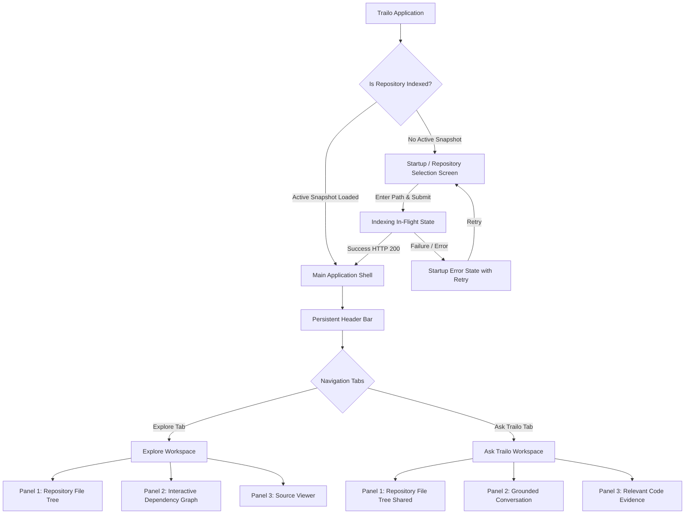

# Trailo — Phase 4B: UI Interaction Specification

**Status:** Revised for Human Review (Phase 4B Focused Revision)
**Target Implementation:** Phase 4C (Interactive Graph and Source Explorer) & Phase 5/6 (Q&A and Citations)
**Document Purpose:** Formal UI interaction contract defining user journeys, layouts, event handling, visual feedback, and API integration boundaries for Trailo.

---

## 1. Purpose and Scope

Trailo is a local-first developer tool designed to help developers understand unfamiliar codebases through visual dependency graphs, source exploration, and evidence-grounded Q&A.

This specification defines the presentation tier for the application:
- User flows from repository selection to graph exploration and Q&A.
- Screen hierarchy and state management between **Explore** and **Ask Trailo** workspaces.
- Panel layouts and flexible sizing designed for a standard laptop screen.
- Truthful data reporting rules (no simulated progress, accurate dependency states, honest citation validation).
- Clear separation between **Core MVP Requirements** and **Optional / Deferred Enhancements**.
- A comprehensive Backend API Matrix distinguishing existing endpoints, Phase 4C prerequisites, and future Phase 5/6 capabilities.

**Boundary Rule:** Phase 4B is strictly a specification task. No frontend components, backend endpoints, or styling changes are implemented in this phase. Phase 4C will implement the Explore interface upon user approval of this document.

---

## 2. Core MVP vs. Optional / Deferred Features

To keep the hackathon MVP realistic and focused on a single student developer workflow, features are explicitly divided into Core MVP and Optional/Deferred:

| Feature / Capability | Classification | Rationale / Boundary |
| :--- | :--- | :--- |
| **Local Path Input & Validation** | **Core MVP** | Essential for specifying repository root. |
| **Indeterminate Indexing State** | **Core MVP** | Real feedback during scan without fabricating progress. |
| **Header with Context & Tab Switcher** | **Core MVP** | Persistent top bar with repo name and Explore / Ask Trailo tabs. |
| **Collapsible Repository File Tree** | **Core MVP** | Left-panel file hierarchy of indexed files only. |
| **Interactive Graph Canvas (Nodes & Directed Edges)** | **Core MVP** | Center panel rendering nodes (files) and directed internal edges (`source` -> `target`). |
| **Basic Graph Controls (Zoom, Pan, Fit-to-View)** | **Core MVP** | Essential for navigating non-trivial graphs. |
| **Node Selection & Source Viewer Sync** | **Core MVP** | Clicking a node opens source code in Right panel. |
| **Edge Selection & Import Details** | **Core MVP** | Clicking an edge displays import specifier and line. |
| **Accurate Empty-State Reporting** | **Core MVP** | Distinguishes no active index, loading, errors, and zero internal edges. |
| **Read-Only Source Viewer with Line Numbers** | **Core MVP** | Displays source code of selected file. |
| **File-Tree Search & Substring Filter** | **Optional / Deferred** | Helpful convenience, but tree navigation suffices for MVP. |
| **Reset-Layout Canvas Button** | **Optional / Deferred** | Fit-to-View and manual pan/zoom cover core canvas needs. |
| **Dimming Unrelated Graph Nodes** | **Optional / Deferred** | Highlighting active node/edge is sufficient; complex canvas dimming deferred. |
| **Closing / Hiding Source Viewer Panel** | **Optional / Deferred** | 3-panel split with collapsible tree and flexible widths covers MVP; dedicated close button deferred. |
| **External Dependency Drawer / UI Inspector** | **Optional / Deferred** | Summary count (e.g. "12 external packages") suffices; dedicated package drawer deferred. |
| **Suggested Starter Questions in Ask Trailo** | **Optional / Deferred** | Welcome prompt with instructions suffices for Phase 5 MVP. |
| **Inference Request Cancellation** | **Optional / Deferred** | Nice-to-have; standard request timeouts handle failures in Phase 5. |
| **Virtual DOM / Virtualized Line Rendering** | **Optional / Deferred** | Standard DOM rendering is sufficient for files within the 500 KB limit. |
| **Full ARIA Tree Grid / Canvas Keyboard Panning** | **Optional / Deferred** | Basic tab navigation, readable contrast, and button labels suffice for MVP. |

---

## 3. Locked Product Design & Principles

1. **Dark, Developer-Centric Theme:**
   - Palette utilizes deep slate backgrounds (`#0b0f19`, `#0f172a`), muted panel borders (`#1e293b`, `#334155`), bright primary text (`#f8fafc`), muted secondary text (`#94a3b8`), and semantic accents (cyan/indigo for active nodes, emerald for verified citations, amber for warnings, rose for errors).
2. **Functional Clarity Over Decoration:**
   - Avoid decorative animations, parallax, heavy glow filters, or non-functional visual noise. Motion is constrained to subtle layout transitions (panel expand/collapse) and canvas pan/zoom.
3. **Dedicated Dual Workspaces (No Floating Modals):**
   - The primary interface consists of two distinct, persistent workspaces: **Explore** and **Ask Trailo**.
   - Q&A is a dedicated workspace with side-by-side evidence inspection, not a floating widget or modal dialog.
4. **Three-Panel Split Layout:**
   - Both workspaces share a unified 3-panel split layout: Left (File Tree), Center (Primary Canvas / Conversation), Right (Source Inspector / Evidence Drawer).
5. **Passive, Read-Only Confinement:**
   - Trailo is strictly an exploratory tool. It contains no file-editing capabilities, commit actions, or code-generation mutators.
6. **Honest Grounding & Uncertainty:**
   - Citations must never be presented as verified without programmatic validation against the indexed snapshot.
   - If a repository has no dependencies, the UI reports this state truthfully rather than showing an error or hallucinating links.
   - Progress indicators must never fabricate per-file percentages or counts.

---

## 4. Application Navigation and Screen Hierarchy

### Screen Hierarchy Diagram



### Persistent Header Bar

The top application bar remains fixed across both workspaces:
- **Brand / Logo:** Compass icon (`🧭`) + **Trailo** logo.
- **Repository Context:** Displays repository name (e.g. `Trailo`), canonical path tooltip, and summary pill (`42 files, 58 dependencies`).
- **Workspace Switcher:** Two distinct tab buttons:
  - `[ 🧭 Explore ]`
  - `[ 💬 Ask Trailo ]`
- **State Invariance:** Switching between `Explore` and `Ask Trailo` retains all in-memory client state:
  - Active graph pan/zoom and selected nodes remain intact.
  - Active open file and scroll offset in the Source Viewer remain intact.
  - Conversation messages, input draft text, and evidence selection in Ask Trailo remain intact.

---

## 5. Startup and Repository Selection Flow

```text
+--------------------------------------------------------------------------+
|  🧭 Trailo                                                   [Local-First] |
+--------------------------------------------------------------------------+
|                                                                          |
|                     Understand any codebase faster.                      |
|       Local-first exploration with dependency graphs & verified Q&A.       |
|                                                                          |
|       +----------------------------------------------------------+       |
|       | Enter local repository path:                             |       |
|       | [ D:/Projects/my-express-api                           ] |       |
|       |                                                          |       |
|       | [ Select & Index Repository ]                            |       |
|       +----------------------------------------------------------+       |
|                                                                          |
|       Examples:                                                          |
|       - C:\Users\dev\projects\web-app                                    |
|       - /home/dev/repos/api-service                                      |
|                                                                          |
+--------------------------------------------------------------------------+
```

### Flow and Requirements
1. **Local Path Entry:**
   - User enters an absolute filesystem path in a text input field.
   - **No Native Folder Picker:** Because standard browser sandboxes cannot open arbitrary OS directories without desktop-specific bindings or special APIs, local text path entry is the designated mechanism for the MVP.
2. **In-Flight Loading State:**
   - Submit button is disabled; input is locked.
   - An indeterminate spinning indicator appears with honest status text: `"Scanning and indexing repository..."`.
   - **No Simulated Progress:** The backend scanner runs as a single asynchronous batch run. The UI **must not** display fake progress bars, simulated percentages (e.g. `45%`), or guessed file counts.
3. **Success Transition:**
   - Backend completes indexing successfully.
   - The UI transitions directly to the **Explore Workspace** with the file tree populated and the dependency graph rendered.
4. **Error Handling & Accurate Error Codes:**
   - If indexing fails, the UI remains on the startup screen and renders a structured error card.
   - **Verified Existing Backend Behavior (`ScannerError`):**
     The existing scanner throws `ScannerError` with the following verified codes:
     - `ROOT_NOT_FOUND`: Target repository root does not exist or cannot be accessed.
     - `INVALID_ROOT`: Root path parameter was missing or empty.
     - `NOT_A_DIRECTORY`: Target path exists but is not a directory.
     - `ROOT_ACCESS_ERROR`: Target directory cannot be inspected due to file-system permissions or I/O failure.
   - **Verified Limit & Traversal Handling:**
     Encountering symlinks outside root or reaching limits (maximum 1,000 files or 20 MB total content) does **not** throw fatal error codes in the existing scanner. Instead, the scanner skips those entries (`symlink_outside_root`, `max_files_limit_reached`, `max_bytes_limit_reached`) and appends non-fatal warnings to `warnings`, returning a valid bounded snapshot.
   - **Proposed Phase 4C Route Error Handling:**
     When the `POST /api/scan` route is implemented in Phase 4C, it will map existing `ScannerError` codes to structured HTTP responses:
     - `ROOT_NOT_FOUND` -> HTTP 404 `{ error: { code: 'ROOT_NOT_FOUND', message: '...' } }`
     - `INVALID_ROOT` / `NOT_A_DIRECTORY` -> HTTP 400 `{ error: { code: 'INVALID_ROOT' | 'NOT_A_DIRECTORY', message: '...' } }`
     - `ROOT_ACCESS_ERROR` -> HTTP 403 / 500 `{ error: { code: 'ROOT_ACCESS_ERROR', message: '...' } }`
     - Proposed validation rejection for malformed traversal paths in client requests: HTTP 400 `{ error: { code: 'PATH_TRAVERSAL', message: '...' } }`.
     - Non-fatal warnings are returned inside the HTTP 200 payload (`{ repositoryId, summary, warnings }`) and surfaced as warning pills in the UI.
   - The input field is re-enabled, focus is restored, and a `"Try Again"` button is provided.

---

## 6. Explore Workspace Layout and Interactions

```text
+----------------------------------------------------------------------------------------------------------------+
| 🧭 Trailo  |  my-express-api  (42 files, 58 edges)                     [ Explore (Active) ]  [ Ask Trailo ]    |
+-------------------+---------------------------------------------------+----------------------------------------+
| FILE TREE         | DEPENDENCY GRAPH                                  | SOURCE VIEWER                          |
| [Collapse <]      | [Zoom +] [Zoom -] [Fit View]                      | src/controllers/user.js   (142 lines)  |
|                   |                                                   +----------------------------------------+
| v src             |       [server.js]                                 | 1  | import express from 'express';   |
|   v controllers   |            |                                      | 2  | import { getUser } from '../...';|
|     * user.js  <--|------------+ (active node)                        | 3  |                                  |
|     * auth.js     |            v                                      | 4  | export async function handle...  |
|   v models        |      [user.js] =====> [db.js]                     | 5  |   const id = req.params.id;      |
|     * userModel.js|                     (edge selected)               | 6  |   return await getUser(id);      |
|   * server.js     |                                                   | 7  | }                                |
| * package.json    |                                                   |                                        |
+-------------------+---------------------------------------------------+----------------------------------------+
```

### Left Panel: Repository File Tree (Core MVP)
- **Contents:** Hierarchical folder tree reflecting all indexed files (`snapshot.files`).
- **Strict Inclusion Rule:** Only files indexed by the backend are shown. Excluded directories (`.git`, `node_modules`, `dist`), hidden secrets (`.env`), and skipped binaries are not displayed.
- **Collapse / Expand Toggle:** Sidebar collapse button (`[<]` / `[>]`) allows collapsing the tree to maximize canvas width.
- **File Selection:** Clicking a file highlights the row, highlights the corresponding graph node, and opens the file in the Right Source Viewer.
- *Optional / Deferred:* Tree search input and substring filter.

### Center Panel: Interactive Dependency Graph (Core MVP)
- **Role:** Primary canvas receiving the remaining flex space between panels.
- **Data Source:** Consumes Phase 4A API payload (`GET /api/graph` or `GET /api/repositories/:id/graph`).
- **Canvas Controls (Core MVP):**
  - `[+]` Zoom In
  - `[-]` Zoom Out
  - `[⊡]` Fit to View (centers and bounds-adjusts graph)
  - *Optional / Deferred:* `[↺]` Reset Layout button.
- **Node Interactions:**
  - Displays file name, language badge (`JS`, `TS`, etc.), and line count.
  - Hover: Displays compact tooltip showing normalized repository-relative path (`id`), byte size, and line count.
  - Click: Selects node with distinct accent outline, synchronizes file tree, and opens file in Source Viewer.
  - *Optional / Deferred:* Dimming unrelated graph nodes.
- **Edge Interactions:**
  - Directed edge from importing file (`source`) to imported file (`target`).
  - Click: Highlights edge and displays an edge metadata card:
    - Specifier: `./db.js`
    - Kind: `import` (or `require`, `re-export`)
    - Declared line: Line 2
    - Action: Clicking metadata card jumps the Source Viewer to the declaration line.
- **External & Unresolved Dependencies:**
  - Summary count displays external packages (e.g. `"12 external packages referenced"`).
  - Unresolved imports are surfaced in node/edge metadata cards or summary pills.
  - *Optional / Deferred:* Dedicated external package slide-out drawer.

### Right Panel: Source Viewer (Core MVP)
- **Role:** Read-only, syntax-highlighted code inspection.
- **Header:** Shows relative path, total line count, and language.
- **Code Body:**
  - 1-based line numbers in left gutter.
  - Line-range navigation: Auto-scrolls to and highlights line numbers when jumped to from an edge declaration or citation.
- **Empty State:** Centered placeholder text: `"Select a file from the tree or graph to inspect source code"`.
- **Graceful Error Handling:** If source content is missing or exceeds limits, displays a clean inline alert: `"Source content unavailable for this file."`
- **Security & Confinement Invariant:** Source content is retrieved strictly from the active in-memory index snapshot. The server validates and normalizes the relative path, rejects path traversal, and never uses client-supplied paths to read arbitrary files from disk. Content is served only for files present in the index snapshot.
- *Optional / Deferred:* Dedicated close `[✕]` button to collapse source viewer.
- *Optional / Deferred:* Virtualized line rendering (standard DOM rendering suffices for files under 500 KB).

---

## 7. Dependency Graph Behavior and Truthful Empty States

To avoid misleading users, graph empty states must strictly distinguish between different causes:

| State | Condition | UI Presentation | Classification |
| :--- | :--- | :--- | :--- |
| **No Active Index** | `GET /api/graph` returns HTTP 404 (`REPOSITORY_NOT_FOUND`) | Empty canvas with prominent card: *"No repository is currently indexed. Return to Startup to select a repository."* with button *"Index Repository"*. | Normal empty state |
| **Graph Loading** | `GET /api/graph` is in flight | Subtle pulsing skeleton indicator on canvas. | In-flight loading |
| **Graph Build Error** | `GET /api/graph` returns HTTP 500 (`GRAPH_BUILD_ERROR`) | Error card with message and a *"Retry"* button. | Server error |
| **Files Indexed, No Internal Edges** | HTTP 200, `nodes.length > 0`, `edges.length === 0` | **Renders all file nodes cleanly on canvas.** Displays informational banner: *"No resolved internal dependencies detected."* If `unresolved.length > 0`, adds: *"Note: N unresolved imports detected."* If `external.length > 0`, adds: *"N external packages referenced."* | **Truthful Valid State** (Not an error!) |
| **Isolated Nodes Present** | Nodes with 0 incident edges in a graph with other edges | Renders isolated nodes alongside connected clusters. Never omits isolated files from the graph. | Normal node display |

---

## 8. Ask Trailo Workspace & Future Q&A Flow

```text
+----------------------------------------------------------------------------------------------------------------+
| 🧭 Trailo  |  my-express-api  (42 files, 58 edges)                     [ Explore ]  [ Ask Trailo (Active) ]    |
+-------------------+---------------------------------------------------+----------------------------------------+
| FILE TREE         | GROUNDED CONVERSATION                             | RELEVANT CODE EVIDENCE                 |
|                   |                                                   | 2 verified snippets retrieved          |
| v src             | User:                                             +----------------------------------------+
|   v controllers   | How does user authentication work in this repo?   | EVIDENCE ITEM #1 [Verified]            |
|     * auth.js  <--|                                                   | src/controllers/auth.js:L15-L38        |
|     * user.js     | Trailo (Gemma):                                   | -------------------------------------- |
|   v middleware    | Authentication is handled in authController.js    | 15 | export async function login(req)  |
|     * verify.js   | via JWT tokens [auth.js:L15-L38]. Requests are    | 16 |   const { email, password } = req |
|                   | validated by verifyToken [verify.js:L10-L24].     | ...| ...                               |
|                   |                                                   | [ Open in Explore ]                    |
|                   | +-----------------------------------------------+ |----------------------------------------|
|                   | | Ask a follow-up about this repository...  [>] | | EVIDENCE ITEM #2 [Verified]            |
|                   | +-----------------------------------------------+ | src/middleware/verify.js:L10-L24       |
+-------------------+---------------------------------------------------+----------------------------------------+
```

### Ask Trailo Principles (Dedicated Workspace, Not a Popup)
- **Shared Repository Context:** Reuses the file tree on the left.
- **Side-by-Side Verification:** Center panel contains the grounded conversation; Right panel contains the cited code evidence so explanations and source excerpts are visible simultaneously.
- **State Invariance:** Chat messages, scroll position, and input drafts remain intact when toggling between Explore and Ask Trailo.

### User Flow
1. User enters natural language question in center panel.
2. In-flight state displays an honest thinking indicator: `"Gemma is analyzing repository evidence..."`.
3. Answer arrives with inline citations (e.g. `[src/controllers/auth.js:L15-L38]`).
4. Supporting evidence cards populate the Right panel.
5. Clicking `[ Open in Explore ]` on an evidence card:
   - Switches active tab to **Explore**.
   - Selects the file in the tree and graph.
   - Opens the file in the Source Viewer and scrolls to cited line range.
   - Returning to `[ Ask Trailo ]` restores the conversation exactly as left.

### Phase Dependency Notice
- *Ask Trailo depends on Phase 5 (Q&A Vertical Slice with Ollama) and Phase 6 (Citation Validation).*
- *Do not implement mock or simulated Q&A responses in Phase 4C.*

---

## 9. Citation Validation & Source Navigation (Phase 6)

### Citation Presentation States

| Citation Status | Badge | Presentation & Behavior |
| :--- | :--- | :--- |
| **Verified Citation** | Green pill: `✔ Verified` | Code snippet displayed; inline link is active; `[ Open in Explore ]` button is enabled and navigates to exact lines. |
| **Out-of-Bounds Line Range** | Amber pill: `⚠ Invalid Range` | Cited lines exceed file length in active snapshot. Displays warning: *"Cited lines exceed indexed file bounds"*. Navigation is disabled. |
| **Unindexed File Reference** | Rose pill: `✕ Unindexed File` | Model referenced a file not in `snapshot.files`. Displays warning: *"File not found in active repository index"*. Navigation is disabled. |
| **Insufficient Evidence** | Slate banner: `ℹ Insufficient Evidence` | Model acknowledges lack of evidence in retrieved chunks. UI displays polite refusal without fabricated citations. |

---

## 10. Realistic Phase 4C Implementation & Sizing Guidelines

To ensure smooth implementation on a student laptop without layout breaks:

### Flexible Panel Proportions
Instead of rigid pixel minimums that break on 1366x768 screens, use flexible proportional sizing with sensible bounds:
- **Left Panel (File Tree):** Default ~20% width (min 180px, max 350px). Can be collapsed to 0px via toggle.
- **Center Panel (Graph Canvas):** Flex grow (min 300px). Takes all remaining space.
- **Right Panel (Source Viewer):** Default ~35% width (min 280px, max 500px).
- **Splitter Handles:** Standard 4px divider handles with `col-resize` cursor.

### Pragmatic Component Architecture
- Use established lightweight React libraries for graph rendering (e.g. `@xyflow/react` / React Flow) rather than custom canvas engines.
- Defer DOM virtualization until repository size demands it; standard React list rendering is sufficient for files under 500 KB.
- Avoid introducing state management frameworks (Redux, Zustand) if React `useState` / `useContext` at workspace level suffices.

### Essential Accessibility (Realistic MVP Scope)
- Ensure readable contrast (minimum 4.5:1 text-to-background ratio).
- Provide explicit `aria-label` attributes on icon-only buttons (`Zoom in`, `Zoom out`, `Fit view`, `Collapse sidebar`).
- Ensure visible keyboard focus rings on interactive elements.
- Use `role="status"` on loading and error banners.
- *Avoid claiming formal WCAG AA compliance until audit tools have verified it.*

---

## 11. Backend / API Compatibility & Readiness Matrix

This matrix categorizes all application capabilities against the actual codebase:

| Capability | Current Backend State | Required Frontend Behavior | Classification | Target Phase |
| :--- | :--- | :--- | :--- | :--- |
| **Dependency Graph Retrieval** | `GET /api/graph` and `GET /api/repositories/:id/graph` implemented & verified (61 tests pass). | Explore canvas fetches and renders nodes, directed edges, and counts. | **Existing** | Complete (Phase 4A) |
| **In-Memory Snapshot Identity** | `IndexStore` stores active snapshot with `id`, `rootPath`, `indexedAt`, and `stats`. | Top bar displays repository name, file count, and dependency count. | **Existing** | Complete (Phase 4A) |
| **Trigger Repository Scan** | `indexRepository(rootPath)` exists in backend JS, but no HTTP route is exposed in `app.js`. | Startup screen sends path to initiate scanning. | **Phase 4C Prerequisite** | Phase 4C step 1 |
| **Serve Source File Content** | File records in `snapshot.files` hold text content, but no HTTP route serves it. | Source Viewer fetches content of selected file. | **Phase 4C Prerequisite** (Must retrieve strictly from in-memory snapshot; validate path; reject traversal; no arbitrary disk reads) | Phase 4C step 1 |
| **File Tree Listing** | Nodes array in `GET /api/graph` contains all indexed file paths. | File tree constructs hierarchy from `nodes` array. | **Existing (via Graph API)** | Complete (Phase 4A) |
| **Scan Progress Streaming** | Batch Promise execution only; 0 progress callbacks. | Startup screen displays indeterminate loading state. | **Optional / Deferred** | Post-MVP |
| **Q&A Chat Endpoint** | No route or controller exists. | Ask Trailo sends question, receives answer and citations. | **Phase 5 Feature** | Phase 5 |
| **Evidence Retrieval Engine** | Chunker exists, but heuristic search/ranking engine is not implemented. | Evidence panel renders retrieved code chunks. | **Phase 5 Feature** | Phase 5 |
| **Citation Validation Service** | Deterministic line chunks exist, but no validator checks LLM citations. | UI displays Verified vs Unverified badges. | **Phase 6 Feature** | Phase 6 |

---

## 12. Minimal Phase 4C Prerequisites & Roadmap Sequencing

To enable the complete Explore user journey in Phase 4C (Scan -> Graph -> Source Inspection), two small backend prerequisites must be added:

1. **Scan Route (`POST /api/scan` or `POST /api/repositories`):**
   - Accepts `{ rootPath: string }`.
   - Calls `indexRepository(rootPath)`.
   - Catches `ScannerError` and maps verified error codes (`ROOT_NOT_FOUND`, `INVALID_ROOT`, `NOT_A_DIRECTORY`, `ROOT_ACCESS_ERROR`) to appropriate HTTP status codes.
   - Returns HTTP 200 with `{ repositoryId, summary, warnings }` on success, or structured error on failure.
2. **File Content Route (`GET /api/files/:path` or `GET /api/repositories/:id/files/*`):**
   - **In-Memory Retrieval Only:** Retrieves source content strictly from the active in-memory snapshot via `store.getFile(filePath)`. Never uses client-supplied paths to execute `fs.readFile` or read arbitrary files from disk.
   - **Path Validation & Traversal Defense:** Validates and normalizes the repository-relative path (POSIX forward slashes, rejects `..` traversal sequences, leading slashes, and Windows drive prefixes).
   - **Index Presence Enforcement:** Returns content only for files present in the active snapshot index (`snapshot.filesMap`). If the path is not present in the index snapshot, returns HTTP 404 `{ error: { code: 'FILE_NOT_FOUND', message: 'File not found in active repository index' } }`. If traversal or invalid syntax is detected, returns HTTP 400 `{ error: { code: 'INVALID_FILE_PATH', message: 'Path traversal or invalid relative path rejected' } }`.
   - **Response Payload:** Returns HTTP 200 with `{ path, content, lineCount, language }`.

**Roadmap Recommendation:** Implement these two minimal endpoints as the opening step of Phase 4C before connecting the frontend UI.

---

## 13. Acceptance Criteria for Phase 4B & Phase 4C

### Acceptance Criteria for Phase 4B (This Specification)
1. `docs/UI_INTERACTION_SPEC.md` clearly separates Core MVP requirements from Optional/Deferred enhancements.
2. The Explore workspace is fully defined with a 3-panel layout (File Tree | Graph | Source Viewer).
3. The Ask Trailo workspace is defined as a dedicated workspace with side-by-side conversation and code evidence.
4. Startup flow specifies local text path input and truthful indeterminate progress (no fake percentages).
5. Graph empty states accurately distinguish between no active index, loading, server errors, and repositories with zero resolved internal dependencies.
6. The Backend Compatibility Matrix accurately labels all capabilities as Existing, Phase 4C Prerequisite, Phase 5, Phase 6, or Optional/Deferred.
7. Error handling accurately distinguishes verified existing `ScannerError` codes (`ROOT_NOT_FOUND`, `NOT_A_DIRECTORY`, `INVALID_ROOT`, `ROOT_ACCESS_ERROR`) and non-fatal warnings from proposed Phase 4C HTTP route error mapping.
8. Source-content endpoint security requires retrieving content strictly from the active in-memory index snapshot, validating relative paths, rejecting path traversal, and never reading arbitrary disk files.
9. No application code or tests have been modified in this phase.

### Acceptance Criteria for Phase 4C (Future Implementation)
1. Startup screen allows entering a local repository path and displays real loading/error states.
2. Explore workspace renders the 3-panel layout with collapsible tree and flexible sizing.
3. Central graph renders nodes and directed edges using Phase 4A payload, supporting zoom, pan, and fit-to-view.
4. Clicking a node or tree item opens the file in the read-only Source Viewer with line numbers.
5. Clicking an edge highlights the relationship and displays import details.
6. Repositories with no internal dependencies render file nodes with an honest explanatory message.
7. Switching between Explore and Ask Trailo tabs preserves repository context.
8. Source-content endpoint retrieves text strictly from the active in-memory index snapshot, enforces path normalization, and rejects path traversal without arbitrary disk I/O.
